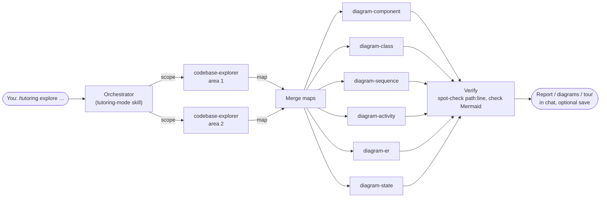

# tutoring-mode

A Claude skill that turns Claude into a structured coding tutor instead of a code generator — built for anyone who needs to actually *understand* the code they work with, not just ship it. Useful if you have to explain or demo your code live (team standups, college project demos), if you're learning to code while working on real tasks, or if you've just joined a project and need to understand code someone else wrote.

Two modes, both tutoring:

- **Build** — learn by *making* something new. Claude teaches while the work gets done.
- **Explore** — learn by *understanding* something that already exists. Read-only: reports, UML diagrams, and guided tours of a codebase, produced by a team of specialist agents.

Every explanation, in every mode, is written **like you're 12** (analogy → small example → the real code) and always tells you **where things are** — file and line range, not just a function name.

## Commands

```
/tutoring                              asks: "Are we exploring or building something today?"
/tutoring --high | --medium | --low    asks the same, then uses that level for build
```

### Build

| Command | What happens |
|---|---|
| `/tutoring build --high` | **You build it.** Claude explains the problem, offers 2–3 possible solutions, breaks the chosen one into a checklist of subtasks, then for each subtask: a lesson, a quick check, **you write the code** (Claude can give you a skeleton with TODOs), and a review — max 3 attempts before Claude shows the answer. |
| `/tutoring build --medium` (default) | **Claude builds, you're quizzed.** Claude codes and explains one logical unit at a time, then quizzes you (max 3 questions) before moving on. |
| `/tutoring build --low` | **Claude builds fast, you get the recap.** Full solution first, then a short spoken-form summary (for saying out loud in a standup), a full write-up with references, and a table of every file and line range touched. |

### Explore (read-only)

| Command | What you get |
|---|---|
| `/tutoring explore report --low` | One-page overview: what it is, the main parts, a component diagram, where it starts, and the 5 files to read first. |
| `/tutoring explore report --high` | Full report: every component, entry points, key classes, the main flow step by step (with a sequence diagram), data, outside services, a glossary, and a reading guide. |
| `/tutoring explore diagram <type>` | One UML diagram, with a plain-language "how to read it" and a table linking every element to its file and line. |
| `/tutoring explore diagram all` | Every diagram type that applies to this codebase (skips the ones that don't, and says why). |
| `/tutoring explore tour --medium` (default) | A guided walk through the code, one unit at a time, with quizzes. |
| `/tutoring explore tour --high` | The same walk, with hands-on tasks in the real code: *predict then check*, *trace it*, *find it*, *explain it back*. |

**Diagram types:** `component` (the big parts and how they connect) · `class` (classes and how they relate) · `sequence` (who calls whom, in order, for one flow) · `activity` (steps and decisions in one process) · `er` (database tables and how they link) · `state` (the states one thing moves through).

Add a focus after any explore command — a folder, a feature, or a flow: `/tutoring explore diagram sequence checkout flow`.

Results show in chat first. Claude then offers to save them to `.tutoring/explore/` in your project — and asks first whether to add `.tutoring/` to `.gitignore`. Explore never changes your code.

### Viewing the diagrams

Diagrams are written in [Mermaid](https://mermaid.js.org/), a text format that a viewer turns into a picture. In a terminal you'll see the text; to see the drawing, open it in any of these:

- **VS Code** — install the [Markdown Preview Mermaid Support](https://marketplace.visualstudio.com/items?itemName=bierner.markdown-mermaid) extension, open the saved `.md` file (e.g. `.tutoring/explore/diagrams/component.md`), and press `Ctrl+Shift+V` (`Cmd+Shift+V` on Mac). VS Code's built-in preview doesn't draw Mermaid without it.
- **GitHub** — draws Mermaid automatically in any `.md` file, issue, or PR.
- **[mermaid.live](https://mermaid.live)** — paste one diagram's text (the part inside ` ```mermaid `) to see and export it as PNG or SVG.

## Architecture

Explore mode is an **orchestrator–worker** multi-agent system. The skill, running in the main Claude session, acts as the orchestrator; specialist subagents do the reading and drawing.



Design choices:

- **Read the code once.** One explorer (or several in parallel, one per area of a large repo) builds a structured **map** where every item has a verified `path:line`. The diagram agents work from that map instead of each re-reading the codebase — cheaper, faster, and every diagram tells the same story.
- **One specialist per diagram type.** Each diagram agent has a short, focused prompt with the rules for its own UML type and Mermaid syntax, so diagrams break less often. They run in parallel.
- **Traceable by design.** Every box and arrow must link to real code. The orchestrator spot-checks locations and validates the Mermaid before showing anything; anything unconfirmed is labeled *unverified*, not drawn as fact.
- **Least privilege.** All subagents are read-only (`Read`, `Grep`, `Glob`). Only the orchestrator can write, and only to `.tutoring/explore/` after you say yes.
- **Graceful fallback.** Where subagents aren't available (Claude.ai), the skill runs the same steps itself, one after another.

## Repository layout

```
.claude-plugin/
  plugin.json                       plugin manifest
  marketplace.json                  lets Claude Code install the plugin from this repo
skills/tutoring-mode/
  SKILL.md                          commands, mode selection, shared rules
  references/
    teaching-style.md               "explain like I'm 12" + always say where things are
    build/high.md · medium.md · low.md
    explore/orchestration.md        how the agents are dispatched, merged, verified, saved
    explore/report.md · tour.md
    explore/fallback.md             same steps without subagents (Claude.ai)
agents/
  codebase-explorer.md              read-only mapper
  diagram-component.md · diagram-class.md · diagram-sequence.md
  diagram-activity.md · diagram-er.md · diagram-state.md
```

## Installing

### Claude Code — as a plugin (skill + agents together)

```
/plugin marketplace add EngraciaBatista/Claude-Tutoring-Skill
/plugin install tutoring-mode@engracia-tutoring
```

### Claude Code — manually

Copy the skill and the agents into your Claude folder — `~/.claude/` for all projects, or `.claude/` in a project root for that project only:

- `skills/tutoring-mode/` → `~/.claude/skills/tutoring-mode/`
- `agents/*.md` → `~/.claude/agents/`

Build mode works with just the skill. Explore mode needs the agents for the multi-agent version; without them it uses the fallback.

### Claude.ai (web/desktop/mobile)

1. Zip the `skills/tutoring-mode/` folder.
2. In Claude.ai, go to **Customize → Skills → "+ Create skill" → Upload a skill** and upload the zip.
3. Toggle it on.

> Requires Code execution and file creation to be enabled (Settings → Capabilities, or your org's Skills settings if you're on a Team/Enterprise plan).

Claude.ai skills can't launch subagents, so explore mode runs its steps one after another instead of in parallel. Upload the code (or connect the repository) so Claude can read it. For large codebases, Claude Code gives better results.

## Why

Built out of a very specific, very human problem: using an AI coding assistant so much that you stop understanding your own code well enough to explain it under pressure. This skill doesn't stop you from using Claude to code — it structures *how* you use it, so speed and understanding aren't fully at odds. Explore mode extends the same idea to code you didn't write: instead of a summary you forget tomorrow, you get a map, diagrams you can come back to, and a tour that makes sure it stuck.

## License

[CC BY 4.0](./LICENSE) — you're free to use, modify, and share this (including publishing your own modified version, even commercially), as long as you credit Engracia and link back to this repository.
